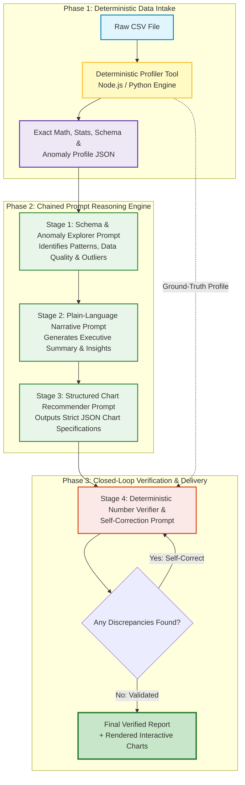

# VeriSight AI — Tool-Assisted & Self-Verifying Data Analysis Report Writer
> **Academic Prompt Engineering Mini-Project | Problem ID: C21**  
> *Translating Raw Tabular Datasets into Fact-Checked, Plain-Language Executive Summaries and Actionable Visualizations*

---

## 📌 Executive Summary & Problem Statement

Modern data workflows are bottlenecked by the gap between raw quantitative outputs and executive comprehension. Students, academic researchers, and business analysts frequently work with tabular data (CSV formats), yet extracting meaningful findings, explaining them in clear non-technical prose, and selecting the most appropriate charts remains time-consuming and error-prone.

While Large Language Models (LLMs) have emerged as powerful tools for natural language synthesis, **direct single-shot prompting on raw CSV files is fundamentally unreliable for quantitative analytics**.

### Why Single-Shot LLM Prompts Fail on CSV Data:
1. **Arithmetic & Statistical Hallucination**: LLMs are autoregressive token predictors, not calculators. When presented with 50+ rows of numbers, they frequently fabricate means, miscalculate growth percentages, invert correlations, and invent trends that do not exist in the ground-truth data.
2. **Schema Blindness & Token Saturation**: Raw CSV files dump repetitive commas, headers, and noisy records into the LLM context window. This leads to attention degradation, lost-in-the-middle phenomena, truncation of larger datasets, and misinterpretation of column datatypes (e.g., treating zip codes or IDs as numerical metrics).
3. **Suboptimal & Hallucinated Chart Selection**: LLMs without strict visual grammar grounding often recommend unsuited charts (e.g., suggesting a 3D pie chart for high-cardinality time-series data) or specify visual attributes that do not map to valid plotting configurations.
4. **Lack of Verifiable Grounding & Silent Errors**: In single-shot generation, there is no audit trail. When an LLM outputs an incorrect statistic like *"Revenue grew by 43%"*, a human reader cannot tell whether the calculation was genuine or fabricated without manually checking every row.

**VeriSight AI (Problem ID: C21)** solves this challenge by implementing a **Tool-Assisted, 4-Stage Chained Prompt Architecture with Closed-Loop Self-Verification**. Instead of forcing the LLM to perform arithmetic, deterministic tools extract exact statistical summaries, schemas, and anomaly scores, feeding structured JSON into tightly scoped prompt stages that culminate in a self-checking numerical validation pass.

---

## 🎯 Target Users & Stakeholders

| Target Persona | Key Pain Points | VeriSight AI Value Proposition |
| :--- | :--- | :--- |
| **Academic Students & Researchers** | Struggling to interpret statistical outputs for course projects, theses, or lab findings without deep statistical coding skills. | Instant plain-language interpretation grounded in verified statistical metrics, with ready-to-cite findings. |
| **Junior Business & Data Analysts** | Spending excessive hours manually writing weekly executive summaries and crafting charts from CSV dumps. | Automated draft generation with reproducible audit trails and pre-formatted chart configs (Vega-Lite/Chart.js). |
| **Non-Technical Domain Managers** | Intimidated by complex spreadsheets; prone to making decisions based on misinterpreted charts or flawed summaries. | Accessible executive narratives with explicit callouts for data anomalies, outliers, and confidence ratings. |

---

## 🏗️ System Architecture & Workflow

VeriSight AI decouples computation from linguistic narration. A deterministic code-based profiler extracts exact summary statistics, quantiles, missing-value counts, and correlations. The LLM is only utilized for semantic reasoning, narrative synthesis, chart taxonomy matching, and adversarial verification.



### Chained Stages Explained:
1. **Deterministic Profiler Tool**: Computes exact counts, missing frequencies, mean, median, standard deviation, min, max, IQR outlier boundaries, and Pearson/Spearman correlation matrices.
2. **Stage 1 (Schema & Anomaly Explorer)**: Analyzes the statistical profile to flag data quality concerns, distribution skewness, and meaningful group differences.
3. **Stage 2 (Plain-Language Narrative Synthesis)**: Transforms technical anomalies into clear executive prose with a 3-tier structure: Executive Takeaways, Deep-Dive Observations, and Strategic Recommendations.
4. **Stage 3 (Structured Chart Recommender)**: Selects optimal chart types (e.g., Bar, Line, Scatter, Heatmap) and generates rigid JSON schemas specifying X/Y encodings, aggregations, and color semantics.
5. **Stage 4 (Deterministic Number Verifier & Self-Correction)**: Extracts every numerical claim made in the generated narrative and cross-checks it against the deterministic JSON profile. If a hallucinated metric is identified, a self-correction prompt repairs the text prior to final presentation.

---

## 🗺️ Mapping to the 10-Stage Prompt Engineering Lifecycle

| Lifecycle Stage | VeriSight AI Implementation Focus | Status |
| :--- | :--- | :---: |
| **Stage 1: Problem Definition & Scope** | Problem ID C21 requirements formalized; defined input CSV constraints, metrics, and success criteria. | ✅ Completed |
| **Stage 2: Baseline Prompting & Failure Analysis** | Benchmarked naive single-shot prompts (`Analyze this CSV: ...`) on synthetic datasets; documented hallucination rates and chart failures. | ✅ Completed |
| **Stage 3: Context Structuring & Data Profiling** | Engineered deterministic data profiler tool to parse CSV and compress it into high-signal JSON metadata. | ✅ Initiated |
| **Stage 4: Prompt Decomposition & Chaining** | Partitioned generation into 4 sequential prompts: Anomaly Analysis $\rightarrow$ Narrative $\rightarrow$ Chart JSON $\rightarrow$ Number Verifier. | ✅ Designed |
| **Stage 5: Persona & Tone Calibration** | Calibrated prompt personas: Data Detective (Stage 1), Executive Communication Lead (Stage 2), Information Architect (Stage 3). | ⏳ Scheduled (M2) |
| **Stage 6: Structured Output Enforcement** | Implemented JSON Schema enforcement with zero markdown wrapper leakage for chart configurations. | ⏳ Scheduled (M2) |
| **Stage 7: Deterministic Tool Integration** | Integrated statistical helper routines for IQR outlier checks, quantile splits, and correlation matrices. | ⏳ Scheduled (M2) |
| **Stage 8: Self-Reflection & Hallucination Auditing** | Established regex/regex-LLM hybrid checking stage that matches narrative figures with Ground Truth JSON. | ⏳ Scheduled (M3) |
| **Stage 9: Quantitative Metric Benchmarking** | Defined evaluation harness: Fact-Check Accuracy %, Chart Relevancy Score (1-5), and BLEU/ROUGE comparison against gold standards. | ⏳ Scheduled (M3) |
| **Stage 10: Ethical Guardrails & Responsible AI** | Incorporated automated PII anonymization, sample-size disclaimers, and human-in-the-loop review markers. | ✅ Designed |

---

## 📁 Repository Organization

```text
├── README.md                           # Project Overview, Architecture & Lifecycle Mapping
├── docs/
│   └── milestone_1_proposal.md         # Comprehensive Milestone 1 Project Proposal & Rubric Spec
├── datasets/
│   ├── test_1_retail_sales.csv         # Retail Sales: Missing values, extreme revenue outlier
│   ├── test_2_student_performance.csv  # Student Marks: Multi-modal distributions, correlation test
│   └── test_3_cloud_server_logs.csv    # DevOps Time-Series: Latency spikes, error cascades
```

---

## 🚀 Synthetic Benchmark Datasets

The project includes three realistic synthetic benchmark datasets specifically constructed to stress-test prompt resilience against missing values, extreme outliers, non-linear correlations, and temporal anomalies:

1. **`test_1_retail_sales.csv`**:
   - *Dimensions*: 35 transactions across 4 geographical regions and 5 product categories.
   - *Stress Features*: 2 intentional null/missing values, 1 extreme bulk purchase revenue outlier ($18,750), and variable discount brackets.
2. **`test_2_student_performance.csv`**:
   - *Dimensions*: 40 student academic profiles across 4 engineering departments.
   - *Stress Features*: Strong correlation between attendance/study hours and CGPA, borderline placement cases, and department-specific performance variances.
3. **`test_3_cloud_server_logs.csv`**:
   - *Dimensions*: 36 periodic server telemetry snapshots across multi-region infrastructure.
   - *Stress Features*: Normal operating baseline transitioning into sudden memory pressure, network connection saturations, and error response cascades.

---

## 👥 Contributors & Academic Context
Developed as part of the Advanced Prompt Engineering & Agentic Systems Curriculum.  
**Problem ID**: C21 ("Data analysis report writer").
