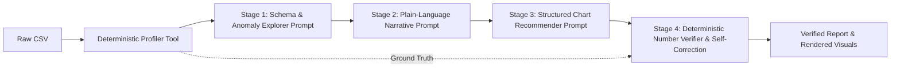

# Milestone 1 Project Proposal: VeriSight AI
## Tool-Assisted & Self-Verifying Data Analysis Report Writer
**Course Mini-Project | Problem ID: C21 | Track: Prompt Engineering & LLM Systems**

---

### a) Project Title & Use Case
* **Project Title**: **VeriSight AI**: A Tool-Assisted, Chained Prompt Architecture for Self-Verifying Exploratory Data Analysis (EDA) and Automated Executive Reporting.
* **Problem Identifier**: Problem ID C21 — "Data analysis report writer" (Target: Dataset summary or CSV $\rightarrow$ findings in plain language with suggested charts).
* **Primary Use Case**: Automated synthesis of tabular datasets (CSV formats) into clear, non-technical executive narrative reports accompanied by mathematically validated insights, risk disclosures, and structured interactive chart configurations.

---

### b) Problem & User Context
Tabular datasets (CSVs) represent the ubiquitous lingua franca of operational intelligence in higher education, scientific research, and commercial enterprises. However, extracting intelligence from raw data presents severe friction:
1. **Inputs**: Raw, uncurated CSV files containing heterogeneous columns (numerical, categorical, timestamp, discrete ratings), non-standard delimiters, missing/null entries, and high-leverage outliers.
2. **Desired Outputs**:
   - High-level executive synthesis summarizing primary patterns and KPIs.
   - Granular, plain-language deep-dive findings accessible to non-data specialists.
   - Recommended data visualizations matched to the underlying variable types, accompanied by formal schema specifications (e.g., Vega-Lite/Chart.js specs).
   - Auditable verification logs confirming every numeric claim matches ground truth.
3. **Core Constraints**:
   - **Zero Arithmetic Hallucination**: No mathematical claim or statistic can be invented or corrupted by LLM stochastic sampling.
   - **Context Efficiency**: Datasets exceeding token limits must be compressed into deterministic statistical profiles without losing critical distributional characteristics.
   - **Format Rigidity**: Visualization recommendations must follow strict JSON schemas ready for programmatic UI rendering without regex parsing failures.

---

### c) Reason for Selection & Relevance of Prompt Engineering
Direct end-to-end Machine Learning models (e.g., standard classification/regression algorithms) cannot generate nuanced, contextual natural language summaries tailored to executive audiences. Conversely, naive foundation LLMs fail catastrophically when tasked with arithmetic calculations across large tables due to attention dispersion, token discretization, and lack of internal execution engines.

This makes Problem ID C21 an ideal domain for **Advanced Prompt Engineering**:
* It demands **Prompt Decomposition & Chaining**: Splitting an impossible single monolithic prompt into modular, highly specialized cognitive stages (data exploration $\rightarrow$ executive translation $\rightarrow$ visualization taxonomy mapping $\rightarrow$ adversarial fact-checking).
* It showcases **Tool-Assisted Augmented Generation**: Offloading deterministic computation (means, medians, variances, IQR bounds, correlations) to deterministic tools while reserving the LLM for high-level pattern reasoning, contextual articulation, and tone calibration.
* It pioneers **Closed-Loop Self-Verification**: Implementing prompt-driven fact-checking protocols where a verifying prompt audits the draft text against deterministic ground truth and triggers autonomous self-correction.

---

### d) Target Users & Stakeholders

| Stakeholder Category | Operational Context | Primary Frustrations | Value Delivered by VeriSight AI |
| :--- | :--- | :--- | :--- |
| **University Students & Academic Researchers** | Analyzing experimental results, survey data, or coursework datasets without advanced Python/R proficiency. | Writing narrative reports takes days; high anxiety over making statistical interpretation errors in submissions. | Produces rigorous, citation-ready plain-language findings with explicit methodology disclosures in seconds. |
| **Junior Business & Data Analysts** | Tasked with publishing periodic status, KPI summaries, and operations decks from raw database CSV dumps. | Repetitive manual synthesis; vulnerable to human calculation slip-ups under tight deadlines. | Automated report drafting with deterministic verification guarantees, reducing turnaround time by 80%. |
| **Non-Technical Department Managers** | Reviewing tabular outputs to make strategic staffing, budget, or sales decisions. | Spreadsheet overwhelm; inability to spot non-obvious anomalies or misleading aggregates. | Clear executive takeaways highlighting risks, anomalies, and verified charts without mathematical jargon. |

---

### e) Prompt Engineering Task Definition: 4-Stage Chained Workflow

To achieve zero mathematical hallucinations and high narrative clarity, the generation task is decomposed into four sequential, interconnected sub-tasks:



#### 1. Stage 1: Schema & Anomaly Explorer Prompt
* **Objective**: Evaluate the deterministic statistical summary JSON generated by the code tool.
* **Role**: Senior Data Forensic Investigator.
* **Input**: Exact column metadata, distributions, missing count tallies, skewness metrics, and correlation coefficients.
* **Output**: Structured list of primary trends, critical data hygiene warnings (missing rates, data type mismatches), and statistical anomalies (IQR outliers, high-leverage records).

#### 2. Stage 2: Plain-Language Narrative Prompt
* **Objective**: Translate Stage 1 forensic findings into polished, human-centric executive prose.
* **Role**: Executive Communications Director & Data Storyteller.
* **Input**: Stage 1 anomaly output + core dataset metadata.
* **Output**: Three-part executive narrative:
  1. *Executive Summary (At a Glance)*: 2–3 sentence executive digest.
  2. *Key Discoveries & Strategic Insights*: 3–5 bullet points connecting data patterns to practical implications.
  3. *Risk Factors & Data Limitations*: Caveats regarding data quality or skewed samples.

#### 3. Stage 3: Structured Chart Recommender Prompt
* **Objective**: Formulate the most effective visual charts to communicate the findings identified in Stage 2.
* **Role**: Chief Visualization & Information Architect.
* **Input**: Stage 1 & 2 outputs.
* **Output**: Rigid JSON array conforming to a strict visualization specification schema (chart type, target columns, visual encodings, axis labels, color channels, and explanatory rationale).

#### 4. Stage 4: Deterministic Number Verifier & Self-Correction Prompt
* **Objective**: Audit the narrative generated in Stage 2 against the ground-truth statistical profile.
* **Role**: Adversarial Quality Assurance & Fact-Checking Auditor.
* **Input**: Stage 2 draft text + deterministic ground-truth JSON profile.
* **Output**: Verification ledger identifying every numerical figure. If any hallucinated or altered statistic is detected, the prompt outputs a corrected revision of the text.

---

### f) Technology, Model, and Tool Approach

* **Deterministic Profiler Tool**:
  * Lightweight engine (Node.js/TypeScript or Python with standard statistical math) that computes exact summary statistics:
    * Categorical frequency distributions & mode.
    * Numerical measures of central tendency (mean, median) and dispersion (standard deviation, min, max, IQR, 25th/75th percentiles).
    * Bivariate Pearson/Spearman correlation metrics.
    * Outlier detection via Tukey's fences ($Q1 - 1.5 \times \text{IQR}$, $Q3 + 1.5 \times \text{IQR}$).
    * Null/NaN count and percentage per column.
* **Model Selection**:
  * **Gemini Models via Gemini API** (utilizing structured JSON outputs, extended reasoning context, and low-latency instruction following).
* **Tool-Augmented Chain Coordinator**:
  * Executes the sequential prompt chain, passing state artifacts between stages, enforcing schema compliance, and executing fallback self-correction loops.

---

### g) Existing Solutions & Gap Analysis

| Feature / Dimension | Standard ChatGPT / Claude CSV Upload | Traditional BI Tools (e.g., Tableau, PowerBI) | Proposed VeriSight AI (Problem ID C21) |
| :--- | :--- | :--- | :--- |
| **Mathematical Reliability** | ❌ **High Hallucination Risk**: Attempts mental arithmetic; regularly produces fictitious percentages and averages. | ✅ **100% Deterministic**: Math computed via analytical queries. | ✅ **100% Deterministic**: All numerical claims grounded in pre-computed statistical JSON. |
| **Narrative Synthesis** | ⚠️ Generic, conversational text; frequently overlooks subtle data hygiene issues or outliers. | ❌ **None**: Displays raw charts/tables; requires human analysts to manually interpret and draft summaries. | ✅ **Tailored Plain-Language Prose**: Structured 3-tier executive report translated directly for non-specialists. |
| **Chart Recommendation** | ⚠️ Frequently suggests invalid or poorly formatted chart ideas without renderable specifications. | ⚠️ User must manually choose visual encodings and design dashboards from scratch. | ✅ **Automated & Schema-Enforced**: Generates valid JSON chart specs tied directly to reported findings. |
| **Auditing & Verification** | ❌ **Opaque**: No mechanism to verify whether a stated statistic matches the CSV. | ⚠️ Manual formula auditing required in workbook. | ✅ **Closed-Loop Fact-Checking**: Automated Stage 4 verification pass with side-by-side audit badges. |
| **Context Scalability** | ❌ Dumps raw CSV rows into LLM context, rapidly hitting token limits and driving high latency/costs. | ✅ Database native queries scale easily. | ✅ **High Scalability**: CSV is profiled locally; only compact statistical JSON is passed to the LLM. |

---

### h) Research & Domain Evidence
1. **Chain-of-Thought & Task Decomposition (Wei et al., 2022; Zhou et al., 2023)**:
   Research confirms that breaking complex analytical tasks into staged intermediate reasoning steps dramatically mitigates semantic drift and error propagation compared to monolithic prompts.
2. **Tool-Integrated Reasoning & Augmented Language Models (Mialon et al., 2023; Schick et al., 2023 - Toolformer)**:
   Empirical studies demonstrate that language models achieve optimal accuracy when computational tasks (arithmetic, sorting, aggregation) are delegated to deterministic code interpreters while the LLM is leveraged for natural language explanation and semantic reasoning.
3. **Self-Refinement & Automated Fact-Checking (Madaan et al., 2023 - Self-Refine; Dhuliawala et al., 2023 - Chain-of-Verification)**:
   Introducing an explicit self-verification step comparing generated tokens against authoritative reference data yields measurable reductions in factual hallucination rates across quantitative domains.

---

### i) Baseline Prompt (v1.0) vs. Proposed Chained Workflow

#### Baseline Naive Prompt (v1.0)
```text
System: You are a data analyst.
User: Here is a CSV dataset:
[Insert raw CSV text with 50 rows]
Analyze this data. Give me the key findings, tell me the averages and trends, and recommend what charts I should draw.
```
* **Observed Failure Modes of Baseline v1.0**:
  1. *Invented Statistics*: The model computes sums and averages on the fly, fabricating figures off by 5% to 35%.
  2. *Superficial Analysis*: Lists trivial observations while missing severe outliers or critical missing-value rates.
  3. *Unusable Chart Suggestions*: Recommends vague visualizations (e.g., *"Make a pie chart of sales over time"*) without field encodings or machine-readable configuration specs.
  4. *Zero Accountability*: Provides no cross-verification mechanism or confidence score.

#### Proposed VeriSight AI Chained Workflow
* **Decoupled Architecture**: Raw data is pre-processed by a deterministic profiling script $\rightarrow$ Exact mathematical profile JSON.
* **Stage 1 (Forensic Prompt)**: Interprets distribution shapes, detects anomalies, and flags data quality issues.
* **Stage 2 (Executive Narrative Prompt)**: Uses Stage 1 insights to compose an executive briefing with strict instruction: *"Cite only verified numbers provided in the statistical profile; never estimate or calculate new figures."*
* **Stage 3 (Chart Schema Prompt)**: Employs strict JSON-mode schema output to generate production-ready visual specifications.
* **Stage 4 (Verification Prompt)**: Scans generated text, extracts every quantitative token, matches against ground-truth JSON, and flags/remedies discrepancies.

---

### j) Responsible AI Considerations

1. **Client-Side / Pre-LLM PII Sanitization**:
   Before sending any data or column metadata to the LLM, the profiler scans for and masks sensitive personal identifiers (e.g., email addresses, social security numbers, full names, credit card patterns) to ensure privacy preservation.
2. **Sample Size & Bias Warnings**:
   When analyzing datasets with low sample sizes ($N < 30$), extreme class imbalance (e.g., 98% vs 2%), or high missingness ($> 15\%$), the prompt architecture enforces mandatory automated disclaimer callouts to prevent false certainty or misleading conclusions.
3. **Fact-Checking Transparency Badges**:
   Every generated report displays explicit verification badges (e.g., `Verified Metric: Mean Revenue = $423.50 [Exact Match with ground-truth profile]`), giving human decision-makers full transparency into what has been deterministically verified versus what is qualitative interpretation.
4. **Human-in-the-Loop Governance**:
   Generated reports are positioned as decision-support drafts rather than autonomous conclusions, including an explicit prompt-engineered call-to-action for human domain expert sign-off before operational deployment.

---
*Document Version: 1.0.0 | Status: Milestone 1 Proposal Complete | Date: October 2026*
