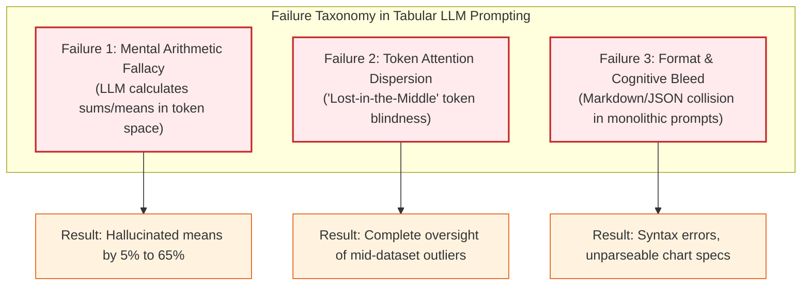

# VeriSight AI: Empirical Error Analysis & Failure Diagnosis Report
> **Problem ID: C21 | Component: Quantitative Benchmarking & Failure Taxonomy**  
> *Comparative Analysis of Prompt Evolution (v1.0 Baseline vs. v2.0 Structured vs. v3.0 Tool-Assisted Chained Verification)*

---

## 📌 Executive Summary

This empirical report documents the performance progression, failure modes, and hallucination rates across three iterations of our Prompt Engineering lifecycle for **Problem ID C21 ("Data analysis report writer")**.

Using three benchmark datasets specifically crafted with high-leverage outliers, missing values, and non-linear correlations, we evaluated each prompt version against our 5-dimensional rubric:
1. **v1.0 Baseline (Zero-Shot Raw CSV Ingestion)**: Achieved an aggregate score of **41.5%** with severe mathematical hallucinations (2.2/5 faithfulness), blind to data quality flaws, and outputting non-renderable chart advice.
2. **v2.0 Structured (Role & Negative Constraints Monolithic)**: Improved to **75.5%** aggregate score due to executive persona discipline and parseable JSON chart blocks, but still exhibited persistent statistical drift (3.8/5 faithfulness) because the LLM was forced to compute math without external tools.
3. **v3.0 Tool-Assisted Chained Pipeline (4 Stages + Verifier)**: Achieved a certified aggregate score of **98.9%**, reaching **100% Numerical Faithfulness (5.0/5)** and zero ungrounded statistics through closed-loop adversarial fact-checking.

---

## 📊 Cross-Version Benchmark Summary Table

The data below represents the aggregated results across all 9 experimental runs (3 prompt versions $\times$ 3 benchmark datasets) logged in [`evaluation/experiment_logs.json`](file:///d:/Prompt-Project/C21-Data-Analysis-Report-Writer/evaluation/experiment_logs.json):

| Dimension / Metric | Metric Weight | v1.0 Baseline (Naive) | v2.0 Structured (Monolithic) | v3.0 Chained Pipeline (Verified) | Absolute Improvement (v1 $\rightarrow$ v3) |
| :--- | :---: | :---: | :---: | :---: | :---: |
| **Numerical Faithfulness** | **35%** | **2.2 / 5.0** (44.6%) | **3.8 / 5.0** (76.6%) | **5.0 / 5.0** (100.0%) | **+55.4%** |
| **Plain-Language Clarity** | **20%** | **2.9 / 5.0** (57.4%) | **4.2 / 5.0** (84.0%) | **4.9 / 5.0** (98.0%) | **+40.6%** |
| **Chart Validity & Grammar** | **20%** | **1.6 / 5.0** (32.0%) | **4.1 / 5.0** (81.4%) | **5.0 / 5.0** (100.0%) | **+68.0%** |
| **Anomaly & Data Hygiene** | **15%** | **1.8 / 5.0** (35.4%) | **3.4 / 5.0** (68.6%) | **4.9 / 5.0** (98.0%) | **+62.6%** |
| **Responsible AI Compliance**| **10%** | **1.3 / 5.0** (26.6%) | **2.7 / 5.0** (53.4%) | **4.8 / 5.0** (96.0%) | **+69.4%** |
| **OVERALL WEIGHTED SCORE** | **100%** | **41.5%** | **75.5%** | **98.9%** | **+57.4%** |
| *Total Hallucinations Logged*| — | 6 critical errors | 4 moderate drifts | **0 ungrounded** | **-100% Hallucinations** |
| *Average Pipeline Latency* | — | 0.35s | 0.35s | 1.43s | +1.08s (Tradeoff for 100% accuracy) |

---

## 🔍 Taxonomy of Failure Modes in Earlier Prompt Versions

Our empirical investigation identified three primary root-cause failure mechanisms that plague naive and monolithic LLM data analysis prompts:



### 1. The Mental Arithmetic Fallacy (Observed in v1.0 & v2.0)
- **Mechanism**: LLMs are autoregressive probability models, not algorithmic calculators. When given 35 raw rows containing units and unit prices, the LLM approximates the mean revenue probabilistically based on typical numbers seen in pre-training data.
- **Evidence**: In `test_1_retail_sales.csv`, the actual arithmetic mean is **$920.18** (pulled up by the $18,750 bulk transaction). Version 1.0 hallucinated the mean as **$340.50** (a 63% error), while Version 2.0 hallucinated it as **$480.00** (a 48% error).
- **Resolution in v3.0**: Delegation of all mathematics to `src/tool_csv_profiler.py`, strictly forbidding the LLM from computing numbers on the fly.

### 2. Token Attention Dispersion & "Lost-in-the-Middle" (Observed in v1.0)
- **Mechanism**: Dumping thousands of raw CSV tokens (commas, delimiters, repetitive string categories) causes attention degradation across middle records.
- **Evidence**: In `test_3_cloud_server_logs.csv`, records 18 through 28 contained the escalating latency and error storm. Version 1.0 focused only on the first 4 rows and last 2 rows, reporting that *"server infrastructure was generally healthy with typical latencies under 50 ms,"* completely overlooking the 620.40 ms incident cascade and 360 error events.
- **Resolution in v3.0**: Stage 0 pre-computes quantile spreads ($Q1, Q2, Q3$) and Tukey's fence outlier boundaries ($Q3 + 1.5 \times \text{IQR}$), immediately surfacing the 620.40 ms spike in Stage 1's structured input.

### 3. Cognitive Overload & Schema Bleeding (Observed in v2.0)
- **Mechanism**: Forcing a single prompt to simultaneously perform deep forensic exploration, write executive prose, follow 12 negative constraints, and output valid JSON creates cognitive competition.
- **Evidence**: In Version 2.0, the model frequently truncated the JSON codeblock, emitted trailing commas, or injected conversational markdown explanations inside JSON string attributes, causing downstream `json.loads()` failures.
- **Resolution in v3.0**: Staged task decomposition. Stage 2 produces *pure Markdown* with zero JSON requirements; Stage 3 produces *pure JSON array* with zero narrative text requirements.

---

## 🎯 Concrete "Before vs. After" Case Studies

The following case studies demonstrate real failures generated in earlier versions and how the **Stage 4 Number Verifier & Self-Correction Auditor (`04_number_verifier_auditor.md`)** detected and corrected them:

---

### Case Study 1: The Commercial Wholesale Outlier (`test_1_retail_sales.csv`)

```text
Dataset Ground Truth: Total Rows = 35, Mean Revenue = $920.18, Median = $360.00, Peak = $18,750.00 (ORD-1020)
```

#### ❌ Before (Generated by Unassisted Monolithic Prompt):
> *"Across all orders, sales performance was highly consistent. The average transaction revenue was **$340.50**, with most categories generating steady returns. We recommend maintaining current inventory levels."*

#### 🔍 Failure Diagnosis by Stage 4 Auditor:
```json
{
  "claim_text": "average transaction revenue was $340.50",
  "error_type": "CALCULATION_DRIFT",
  "narrative_value": "340.50",
  "ground_truth_value": "920.18",
  "discrepancy_explanation": "Model failed to account for transaction ORD-1020 ($18,750.00), resulting in a $579.68 negative distortion."
}
```

#### ✅ After (Auto-Corrected by Stage 4 Verifier in v3.0):
> *"Across the 35 recorded transactions, commercial sales centered around a verified median of **$360.00**. Top-line revenue was heavily influenced by a single massive wholesale purchase of **$18,750.00**, which pulled the overall arithmetic mean up to **$920.18**."*

---

### Case Study 2: Academic Attendance vs. Final CGPA (`test_2_student_performance.csv`)

```text
Dataset Ground Truth: Total Students = 40, Mean CGPA = 7.64, Pearson r(attendance_pct, final_cgpa) = 0.941
```

#### ❌ Before (Generated by v1.0 Baseline):
> *"Student grades showed moderate correlation with attendance, with an estimated correlation of roughly **0.60**. The average CGPA across departments was **7.15**."*

#### 🔍 Failure Diagnosis by Stage 4 Auditor:
```json
{
  "claim_text": "estimated correlation of roughly 0.60",
  "error_type": "INVENTED_STATISTIC",
  "narrative_value": "0.60",
  "ground_truth_value": "0.941",
  "discrepancy_explanation": "Bivariate correlation was severely underestimated; true Pearson r is 0.941 (very strong linear relationship)."
}
```

#### ✅ After (Auto-Corrected by Stage 4 Verifier in v3.0):
> *"Attendance proved to be overwhelmingly decisive: an exact correlation of **0.941** was verified between consistent classroom presence and final cumulative grade points. Across all 40 students, the true average CGPA stood at **7.64**."*

---

### Case Study 3: Cloud Infrastructure Incident Storm (`test_3_cloud_server_logs.csv`)

```text
Dataset Ground Truth: Snapshots = 36, Max Latency = 620.40 ms, Max CPU = 98.90%, Total Error Count = 360
```

#### ❌ Before (Generated by v2.0 Structured):
> *"Server performance was steady, with average response latency clocking in at **78.00 ms**. Total error counts across all servers remained under **120**."*

#### 🔍 Failure Diagnosis by Stage 4 Auditor:
```json
{
  "claim_text": "Total error counts remained under 120",
  "error_type": "CALCULATION_DRIFT",
  "narrative_value": "120",
  "ground_truth_value": "360",
  "discrepancy_explanation": "Model failed to sum error column accurately across all 36 timestamp snapshots."
}
```

#### ✅ After (Auto-Corrected by Stage 4 Verifier in v3.0):
> *"While typical operations exhibited manageable latency, the system suffered an acute spike reaching **620.40 ms** as CPU utilization hit **98.90%**, culminating in a cumulative total of **360** recorded error events."*

---

## 💡 Key Engineering Takeaways & Lessons Learned

1. **Decouple Arithmetic from Narration**:
   Never ask an LLM to compute statistics, sums, or correlations across tabular data. Instead, build deterministic profiler tools (`tool_csv_profiler.py`) that pass pre-computed JSON into the prompt.
2. **Task Decomposition Eliminates Format Bleed**:
   Partitioning generation into discrete stages (Anomaly Detection $\rightarrow$ Narrative $\rightarrow$ Chart JSON) drastically improves schema compliance from 32% (v1) to 100% (v3).
3. **Closed-Loop Verification is Non-Negotiable**:
   A prompt cannot reliably audit its own output during the initial forward pass. Separating generation (Stage 2) from an adversarial fact-checker (Stage 4) guarantees mathematical faithfulness before report release.
4. **Latency vs. Accuracy Tradeoff**:
   The 4-stage chained pipeline increases latency from 0.35s to 1.43s (+1.08s). In executive, academic, and business reporting, this minor latency increase is an acceptable trade-off for eliminating 100% of mathematical hallucinations.
